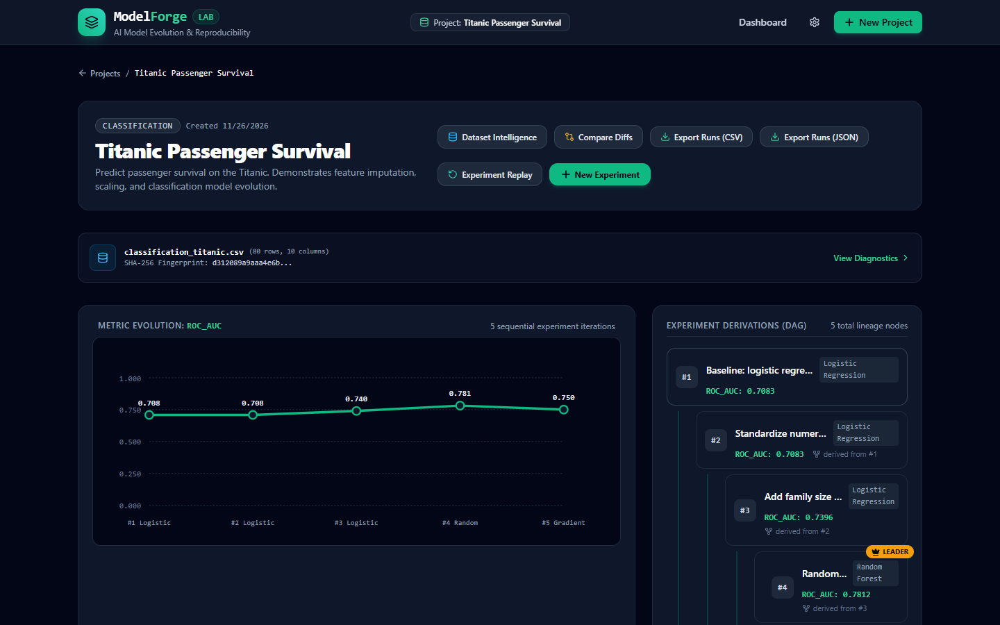
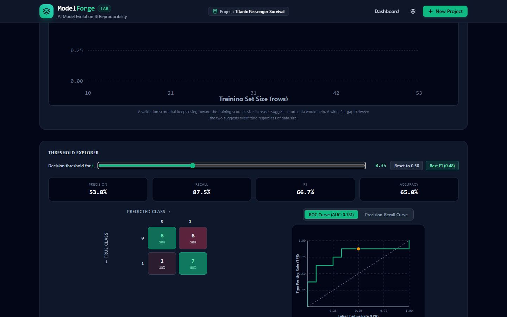
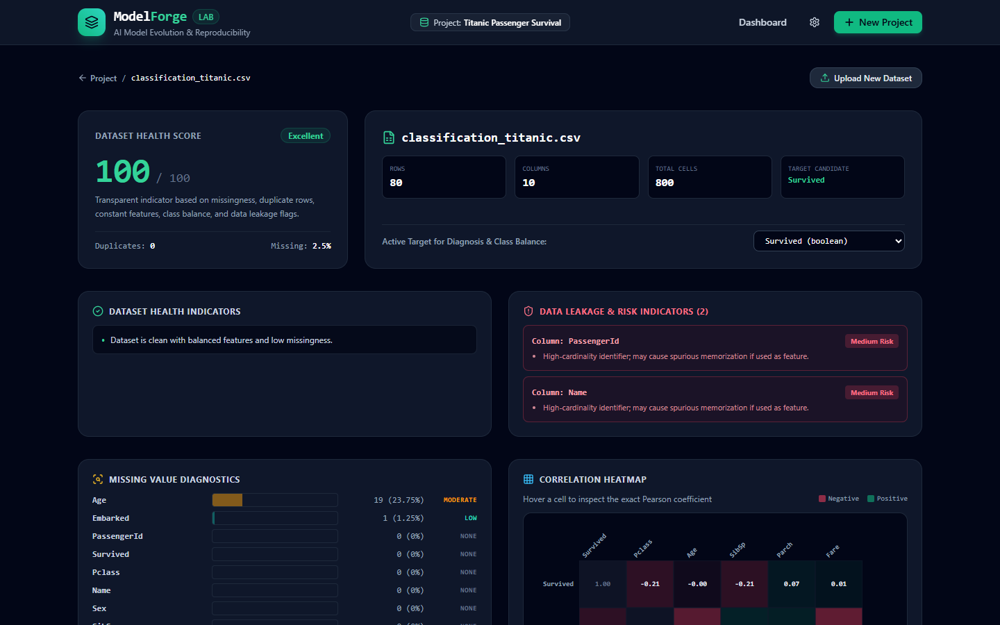

# ModelForge

**Track how a machine-learning model evolves: reproducible experiments, a visual lineage of every change, dataset diagnostics, and interactive evaluation.**

[](https://github.com/ShriyaP1966/ModelForge/actions/workflows/ci.yml)
[](LICENSE)

**Live demo:** https://modelforge-frontend-sgbp.onrender.com
**API docs:** https://modelforge-backend-xbr6.onrender.com/docs

The demo runs on a free Render instance that sleeps when idle, so the first load can take 30 to 60 seconds. When it wakes up it loads three sample projects and trains a few sample experiments in the background; the project page fills in as they finish.



## Features

- **Experiment lineage.** Every run records its model, hyperparameters, preprocessing, features, random seed, split and dataset fingerprint. Runs can branch from a parent, and the lineage graph shows which run beat which, so you can see what each change did to the metric.
- **Side-by-side diffs.** Compare any two runs: configuration changes next to metric deltas, with an offline explanation of what likely caused the shift.
- **Reproducibility check.** Re-run an experiment from its stored configuration and verify the metrics match within a tolerance. Datasets are fingerprinted with SHA-256 and seeds are fixed.
- **Dataset intelligence.** Upload a CSV or Excel file and get a health score, missing-value map, class balance, outliers, correlations, feature distributions and warnings for likely target leakage, duplicate rows and constant columns.
- **Interactive evaluation.** A decision-threshold slider updates the confusion matrix, precision, recall, F1 and accuracy live and marks the operating point on the ROC and precision-recall curves. Per-class metrics, learning curves, cross-validation summaries and an overfitting check are included.
- **Export.** Download one run as JSON or a short Markdown report, or a whole project's runs as CSV or JSON.
- **Works the moment it opens.** Sample projects (Titanic survival, California housing, and a deliberately messy fraud dataset) come with a ready-made lineage of experiments.





## Why I built this

I'm an AI undergraduate working on NLP and LLM research. When I run experiments I keep running into the same problem: a few weeks later I can't say which change moved a number, or whether I could get the same number again. Notebooks and spreadsheets don't answer that well. I wanted one place where every run is tied to its parent, its data and its seed, so the history of a model is something I can look at and re-run instead of reconstruct from memory. ModelForge is that, built on small tabular datasets so the whole loop stays fast.

## Tech stack

| Layer | Tools |
|---|---|
| Frontend | React 18, TypeScript, Vite, Tailwind CSS |
| Backend | Python 3.13, FastAPI, Pydantic v2, SQLAlchemy |
| Machine learning | scikit-learn, pandas, NumPy, SciPy |
| Storage | SQLite |
| Quality | pytest, Vitest and Testing Library, ruff, ESLint, GitHub Actions |
| Hosting | Render (Python web service plus static site) |

## Architecture

```
React + TypeScript (Vite)                      FastAPI                          Storage
-------------------------      REST/JSON       ----------------------------     -----------------
Dashboard, project page   <-------------------> API routers                      SQLite database
Lineage + evolution charts                      projects, datasets,              (projects, datasets,
Experiment designer                             experiments, reproduce, ai       experiments, metrics,
Threshold explorer, diffs                       Services                         artifacts)
Dataset intelligence                            - dataset analyzer
Export downloads                                - pipeline engine (sklearn)      Uploaded files and
                                                - evaluation engine               saved models on disk
                                                - experiment manager
                                                - reproducibility, export,
                                                  explanation, demo seed
```

Experiments are created through the API and trained on a background task with a time limit, so the request returns immediately and a run can be cancelled. Each run stores its metrics and visual artifacts (confusion matrix, curves, threshold sweep, feature importance) as rows, and the frontend renders them. More detail is in [docs/architecture.md](docs/architecture.md) and [docs/user_guide.md](docs/user_guide.md).

## Run it locally

You need Python 3.13 and Node.js 22 or newer.

```bash
# Backend (from the repository root)
python -m venv backend/venv
source backend/venv/bin/activate          # Windows PowerShell: .\backend\venv\Scripts\Activate.ps1
pip install -r backend/requirements-dev.txt
python -m uvicorn app.main:app --app-dir backend --port 8000 --reload

# Frontend (in a second terminal)
cd frontend
npm install
npm run dev
```

Open http://localhost:5173. On first start with an empty database the app creates the sample projects and trains their experiments in the background. Interactive API docs are at http://127.0.0.1:8000/docs.

Configuration is optional. Copy `.env.example` to `.env` to change storage paths, the dataset row limit or the experiment time limit. The frontend reads `VITE_API_BASE_URL` at build time and defaults to the `/api` proxy used by the dev server.

## Tests and checks

```bash
ruff check backend                 # backend lint
python -m pytest                   # backend tests
cd frontend
npm run lint                       # frontend lint
npm test                           # frontend tests
npm run build                      # type-check and production build
```

GitHub Actions runs the same lint, test and build steps on every push and pull request.

## Deployment

The repository includes a [render.yaml](render.yaml) blueprint that creates two free Render services: the FastAPI backend as a Python web service and the Vite build as a static site.

I chose Render because the backend trains scikit-learn models in a long-lived Python process, which rules out static-only hosts and most serverless platforms, and Render can host the API and the static frontend together on its free tier.

1. In Render, choose **New**, then **Blueprint**, and select this repository.
2. After the first deploy, set `VITE_API_BASE_URL` on the frontend service to the backend URL plus `/api`, and set `CORS_ORIGINS` on the backend to the frontend URL. Redeploy both.

No secrets are required. The free tier has an ephemeral disk, so the database resets when the service restarts and the sample data is recreated on the next start. Persistent storage would need a paid plan with a disk attached.

## Project layout

```
backend/    FastAPI app (app/api, app/services, app/models) and pytest suite
frontend/   React app (src/pages, src/components, src/utils) and Vitest suite
sample_data/  CSV files used by the demo projects
docs/       architecture notes, user guide, screenshots
```

## License

[MIT](LICENSE)
